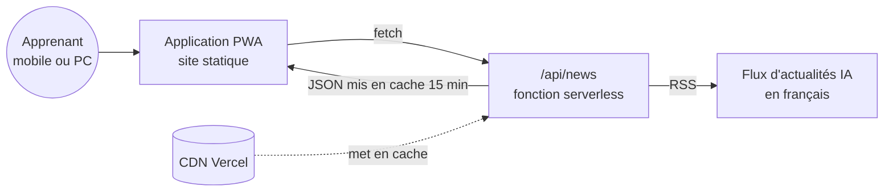

# AfrIA — Apprends l'IA, construis ton avenir


> Plateforme **gratuite** pour aider les **jeunes francophones**, en particulier en Afrique, à apprendre l'intelligence artificielle : modules, parcours et outils pour les enseignants.

🌍 **Démo en ligne : [afria-plateforme.vercel.app](https://afria-plateforme.vercel.app)**

---

## Sommaire

1. [Mission](#1-mission)
2. [Fonctionnalités](#2-fonctionnalités)
3. [Architecture](#3-architecture)
4. [Zoom technique : l'API d'actualités](#4-zoom-technique--lapi-dactualités)
5. [Pensé pour le terrain](#5-pensé-pour-le-terrain)
6. [Feuille de route](#6-feuille-de-route)

---

## 1. Mission

L'IA transforme tous les métiers. Pourtant, les ressources de qualité **en français** et **adaptées au contexte africain** restent rares, et souvent payantes.

AfrIA veut offrir un point d'entrée :

| Principe | Concrètement |
|---|---|
| **Gratuit** | Aucun paiement pour apprendre |
| **En français** | Contenus rédigés pour un public francophone |
| **Accessible** | Application légère, installable, utilisable sur mobile |
| **Ancré dans l'actualité** | Un fil d'actualités IA mis à jour automatiquement |
| **Utile aux enseignants** | Des outils pour enseigner l'IA en classe |

---

## 2. Fonctionnalités

- 📚 **Modules d'apprentissage** progressifs sur l'IA
- 🧑‍🏫 **Outils pour les enseignants**
- 📰 **Fil d'actualités IA automatique**, alimenté par une API serverless
- 📱 **Application installable (PWA)** : icône sur l'écran d'accueil, affichage plein écran
- 🔄 **Mise à jour mensuelle automatisée** du contenu

---

## 3. Architecture



Structure du projet déployé :

```
afrique-ia/
├── manifest.json   # PWA : nom, icônes, couleurs, mode d'affichage autonome
├── api/
│   └── news.js     # fonction serverless : RSS → JSON propre
├── build.js        # assemblage du site au moment du déploiement
└── package.json    # script de build
```

---

## 4. Zoom technique : l'API d'actualités

**Problème** : un navigateur ne peut pas lire directement un flux RSS d'un autre domaine (CORS), et interroger la source à chaque visite serait lent et coûteux.

**Solution** : une **fonction serverless** qui sert d'intermédiaire.

```
Navigateur ──► /api/news ──► flux RSS (IA, en français)
                  │
                  ├─ extrait les 8 articles les plus récents
                  ├─ normalise : titre, lien, date, source
                  ├─ nettoie les balises CDATA
                  └─ répond en JSON, avec un cache CDN
```

**Stratégie de cache** : `Cache-Control: s-maxage=900, stale-while-revalidate=1800`

| Directive | Effet |
|---|---|
| `s-maxage=900` | Le CDN garde la réponse **15 minutes** : la source n'est interrogée qu'environ 4 fois par heure, quel que soit le nombre de visiteurs |
| `stale-while-revalidate=1800` | Pendant 30 minutes supplémentaires, le visiteur reçoit **immédiatement** la version en cache pendant qu'elle se rafraîchit en arrière-plan |

Résultat : un temps de réponse **constant et rapide**, et une charge sur la source **indépendante du trafic**. Avec $N$ visiteurs par heure, le nombre d'appels à la source passe de $N$ à environ 4.

---

## 5. Pensé pour le terrain

| Contrainte du public | Réponse technique |
|---|---|
| Connexions mobiles lentes ou coûteuses | Site statique léger, actualités mises en cache côté CDN |
| Usage majoritairement sur smartphone | PWA installable, orientation portrait, affichage autonome |
| Pas de budget pour s'abonner | Contenu entièrement gratuit |
| Besoin de contenu à jour | Actualités automatiques et mise à jour mensuelle du site |

---

## 6. Feuille de route

- [x] Plateforme en ligne et installable (PWA)
- [x] Fil d'actualités IA automatique
- [x] Mise à jour mensuelle automatisée
- [x] Cours AfrIA intégrés à l'espace Apprentissage de [Teedaïk](https://github.com/Teede-N/teedaik-showcase)
- [ ] Mode **hors ligne** complet (service worker et cache des modules)
- [ ] **Quiz** et suivi de progression
- [ ] Parcours dédiés aux **enseignants** (supports de cours prêts à l'emploi)

---

## 👤 Auteur

**Teede Augustin NOUDAMADJO**, fondateur d'AfrIA · Data Scientist Junior
Licence de mathématiques (École normale supérieure, Bénin) · Master Big Data & IA (ESTIAM Lyon)
[LinkedIn](https://www.linkedin.com/in/teede-noudamadjo) · teedeaugustinnoudamadjo41@gmail.com
