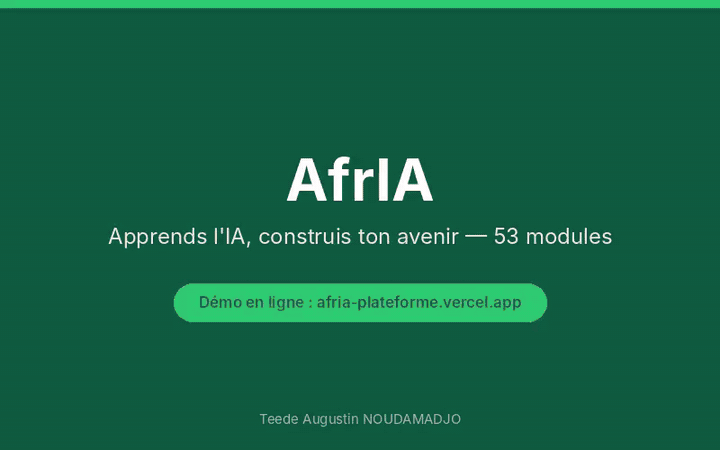
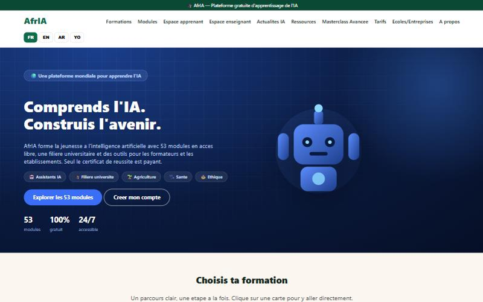
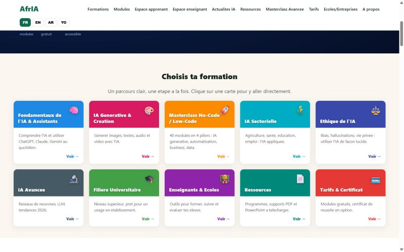
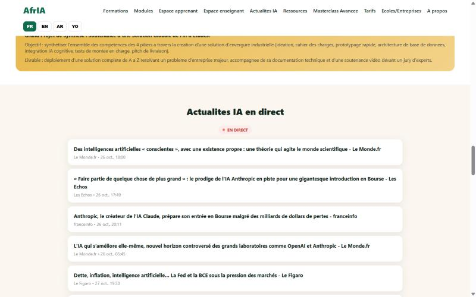
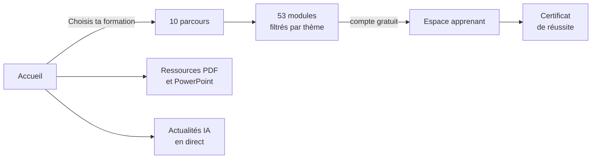
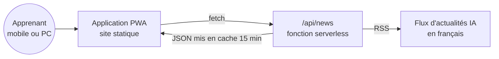

# AfrIA — Comprends l'IA. Construis l'avenir.

> Plateforme **gratuite** pour former la jeunesse à l'intelligence artificielle : **53 modules** en accès libre, une **filière universitaire**, des **outils pour les enseignants** et les établissements. Seul le certificat de réussite est payant.

  
  

  

Démo animée. Cliquez sur <b>Vidéo HD</b> pour la version MP4, ou sur <b>Essayer en ligne</b> pour tester le site.

### 📸 Captures d'écran

<table>
  <tr>
    <td></td>
    <td></td>
    <td></td>
  </tr>
</table>

---

## Sommaire

1. [Mission](#1-mission)
2. [L'offre en chiffres](#2-loffre-en-chiffres)
3. [Fonctionnalités](#3-fonctionnalités)
4. [Parcours utilisateur](#4-parcours-utilisateur)
5. [Architecture](#5-architecture)
6. [Zoom technique : l'API d'actualités](#6-zoom-technique--lapi-dactualités)
7. [Pensé pour le terrain](#7-pensé-pour-le-terrain)
8. [Feuille de route](#8-feuille-de-route)

---

## 1. Mission

L'IA transforme tous les métiers. Pourtant, les ressources de qualité **en français** et **adaptées au contexte africain** restent rares, et souvent payantes. AfrIA offre un point d'entrée **gratuit, accessible 24 h/24 et multilingue**, pour les apprenants comme pour ceux qui les forment.

---

## 2. L'offre en chiffres

| Indicateur | Valeur |
|---|---|
| Modules en accès libre | **53** |
| Coût de l'apprentissage | **0 €** |
| Langues de l'interface | **4** (français, anglais, arabe, yoruba) |
| Parcours thématiques | **10** (fondamentaux, IA générative, masterclass no-code, IA sectorielle, éthique, IA avancée, filière universitaire, enseignants et écoles, ressources, certificat) |
| Masterclass avancée | **40 modules** en 4 piliers, environ 160 h estimées |

---

## 3. Fonctionnalités

| Pour qui | Ce qu'AfrIA propose |
|---|---|
| 🎓 **Apprenants** | 53 modules filtrables par thème (assistants, création, agriculture, santé, éducation, emploi, éthique, avancé, université), compte gratuit, certificat de réussite en option |
| 🧑‍🏫 **Enseignants** | Espace dédié pour déposer des supports de cours et suivre la progression des élèves |
| 🏫 **Écoles et entreprises** | Licence établissement multi-comptes, filière universitaire incluse, demande de démonstration |
| 📚 **Tous** | Ressources téléchargeables gratuitement : programme universitaire (PDF), support PowerPoint, 41 modules en PDF (français et anglais) |
| 📰 **Curieux** | Fil d'**actualités IA en direct**, mis à jour automatiquement |
| 🚀 **Avancés** | Masterclass IA & No-Code de 40 modules, avec vidéos d'approfondissement et un projet de fin de formation |

---

## 4. Parcours utilisateur

L'expérience reste **simple** : une page d'accueil claire, des cartes de couleur pour choisir sa formation en un clic, des filtres par thème et un seul formulaire pour créer son compte.

---

## 5. Architecture

| Élément | Rôle |
|---|---|
| `manifest.json` | Rend le site installable (PWA) : nom, icônes, couleurs, affichage autonome |
| `api/news.js` | Fonction serverless : flux RSS vers JSON propre, avec cache CDN |
| `build.js` | Assemblage du site au moment du déploiement |

---

## 6. Zoom technique : l'API d'actualités

**Problème** : un navigateur ne peut pas lire directement un flux RSS d'un autre domaine (CORS), et interroger la source à chaque visite serait lent et coûteux.

**Solution** : une **fonction serverless** sert d'intermédiaire. Elle extrait les 8 articles les plus récents (titre, lien, date, source), nettoie les balises CDATA et répond en JSON.

**Stratégie de cache** : `Cache-Control: s-maxage=900, stale-while-revalidate=1800`

| Directive | Effet |
|---|---|
| `s-maxage=900` | Le CDN garde la réponse **15 minutes** : la source n'est interrogée qu'environ 4 fois par heure, quel que soit le nombre de visiteurs |
| `stale-while-revalidate=1800` | Pendant 30 minutes supplémentaires, le visiteur reçoit **immédiatement** la version en cache pendant qu'elle se rafraîchit en arrière-plan |

Avec $N$ visiteurs par heure, le nombre d'appels à la source passe de $N$ à environ 4 : la charge devient **indépendante du trafic**.

---

## 7. Pensé pour le terrain

| Contrainte du public | Réponse |
|---|---|
| Connexions mobiles lentes ou coûteuses | Site statique léger, actualités mises en cache côté CDN, PDF téléchargeables |
| Usage majoritairement sur smartphone | PWA installable, affichage autonome |
| Diversité linguistique | Interface en français, anglais, arabe et yoruba |
| Pas de budget pour se former | Tous les modules sont gratuits ; seul le certificat est payant |

---

## 8. Feuille de route

- [x] 53 modules en ligne, 10 parcours, filière universitaire
- [x] Espace enseignant et offre écoles / entreprises
- [x] Ressources téléchargeables (PDF, PowerPoint)
- [x] Actualités IA en direct et mise à jour mensuelle automatisée
- [x] Cours AfrIA intégrés à l'espace Apprentissage de [Teedaïk](https://github.com/Teede-N/teedaik-showcase)
- [ ] Mode hors ligne complet (service worker)
- [ ] Quiz auto-corrigés et tableau de progression détaillé

---

## 👤 Auteur

**Teede Augustin NOUDAMADJO**, fondateur d'AfrIA · Data Scientist Junior
Licence de mathématiques (École normale supérieure, Bénin) · Master Big Data & IA (ESTIAM Lyon)
[LinkedIn](https://www.linkedin.com/in/teede-noudamadjo) · teedeaugustinnoudamadjo41@gmail.com
